# Before / after examples

Cases were chosen by a fixed rule, not by eye: sorted by the default receiver's per-case vehicle recall and taken at evenly spaced quantiles, so the set runs from the worst to the best cases. CARLA v3 recall is against the ground truth (vehicles visible from Rec1 with >= 80 px at 960x540); real-world recall is against the detector on the original photo, as those photos have no ground truth. A vehicle counts as recovered when a detection on the reconstruction overlaps it with IoU >= 0.5.

Each folder holds the original Rec1 photo, the three payload files Rec1 transmits, both reconstructions and `case.json`.

| set | case | details | reference | vehicles | detected (default) | detected (canny 0.7 / seg 1.5) | recall (default) | recall (canny 0.7 / seg 1.5) |
|---|---|---|---|---|---|---|---|---|
| carla_v3 | [case39](carla_v3_case39/) | 5 cameras, WetNoon | ground truth | 6 | 1 | 6 | 0.17 | 0.33 |
| carla_v3 | [case4](carla_v3_case4/) | 6 cameras, SoftRainNoon | ground truth | 9 | 8 | 8 | 0.33 | 0.67 |
| carla_v3 | [case55](carla_v3_case55/) | 5 cameras, ClearNoon | ground truth | 8 | 5 | 6 | 0.38 | 0.62 |
| carla_v3 | [case109](carla_v3_case109/) | 3 cameras, ClearNoon | ground truth | 16 | 12 | 18 | 0.44 | 0.56 |
| carla_v3 | [case46](carla_v3_case46/) | 4 cameras, SoftRainNoon | ground truth | 8 | 9 | 11 | 0.50 | 0.75 |
| carla_v3 | [case90](carla_v3_case90/) | 4 cameras, WetCloudySunset | ground truth | 6 | 3 | 4 | 0.50 | 0.67 |
| carla_v3 | [case1](carla_v3_case1/) | 3 cameras, ClearNoon | ground truth | 7 | 4 | 5 | 0.57 | 0.71 |
| carla_v3 | [case92](carla_v3_case92/) | 6 cameras, CloudyNoon | ground truth | 5 | 3 | 4 | 0.60 | 0.60 |
| carla_v3 | [case100](carla_v3_case100/) | 6 cameras, SoftRainNoon | ground truth | 11 | 19 | 17 | 0.73 | 0.82 |
| carla_v3 | [case14](carla_v3_case14/) | 4 cameras, CloudyNoon | ground truth | 7 | 12 | 11 | 1.00 | 1.00 |
| real_world | [case235](real_world_case235/) | 3 phones | detector on original | 20 | 6 | 12 | 0.25 | 0.45 |
| real_world | [case289](real_world_case289/) | 3 phones | detector on original | 18 | 6 | 8 | 0.33 | 0.39 |
| real_world | [case319](real_world_case319/) | 3 phones | detector on original | 12 | 7 | 10 | 0.42 | 0.58 |
| real_world | [case73](real_world_case73/) | 3 phones | detector on original | 4 | 2 | 3 | 0.50 | 0.75 |
| real_world | [case307](real_world_case307/) | 3 phones | detector on original | 12 | 6 | 9 | 0.50 | 0.75 |
| real_world | [case109](real_world_case109/) | 3 phones | detector on original | 5 | 3 | 4 | 0.60 | 0.60 |
| real_world | [case13](real_world_case13/) | 3 phones | detector on original | 22 | 24 | 22 | 0.73 | 0.77 |
| real_world | [case49](real_world_case49/) | 3 phones | detector on original | 4 | 5 | 6 | 1.00 | 1.00 |

### carla_v3 case39

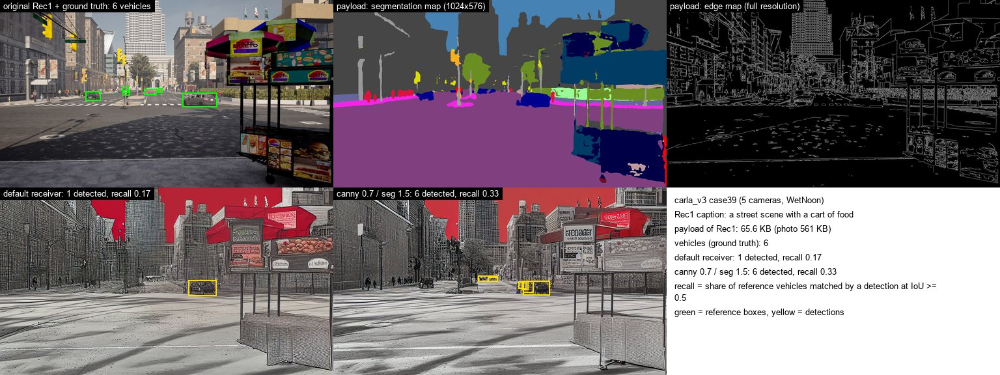

### carla_v3 case4

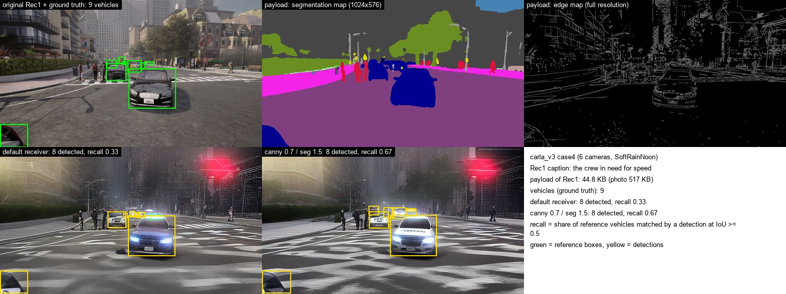

### carla_v3 case55

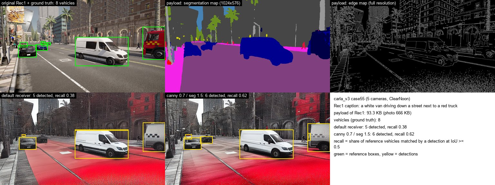

### carla_v3 case109

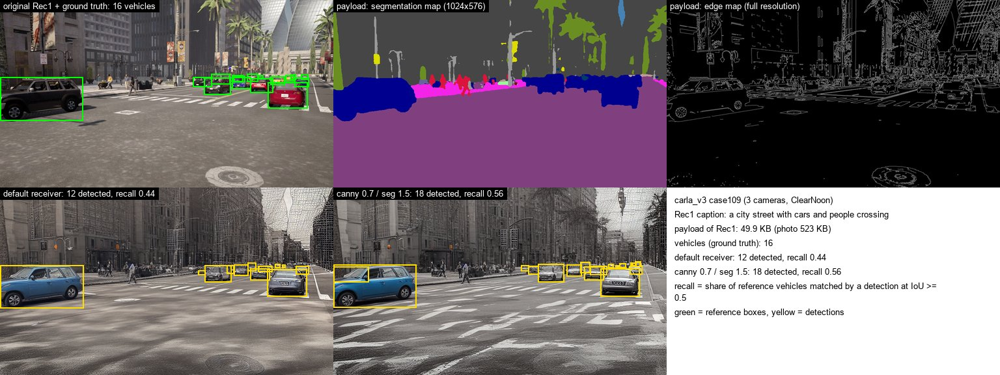

### carla_v3 case46

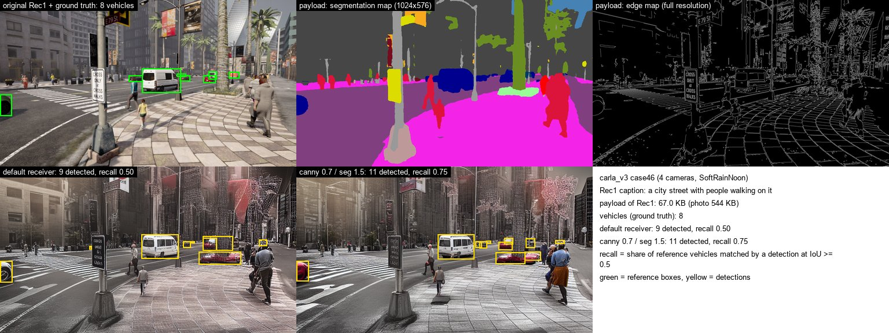

### carla_v3 case90

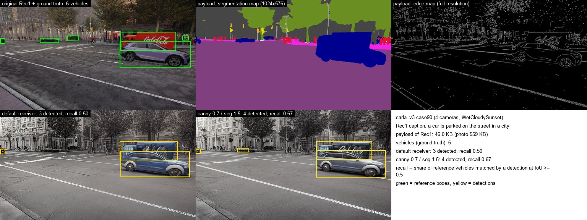

### carla_v3 case1

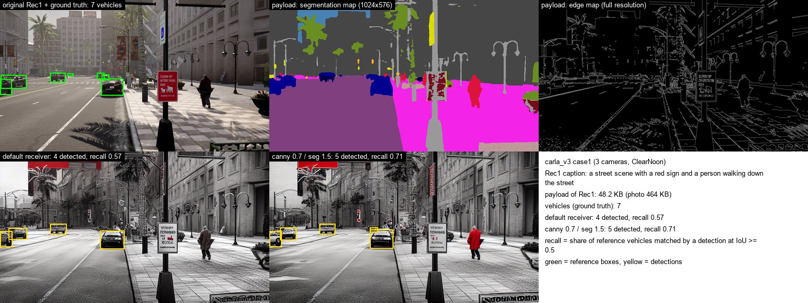

### carla_v3 case92

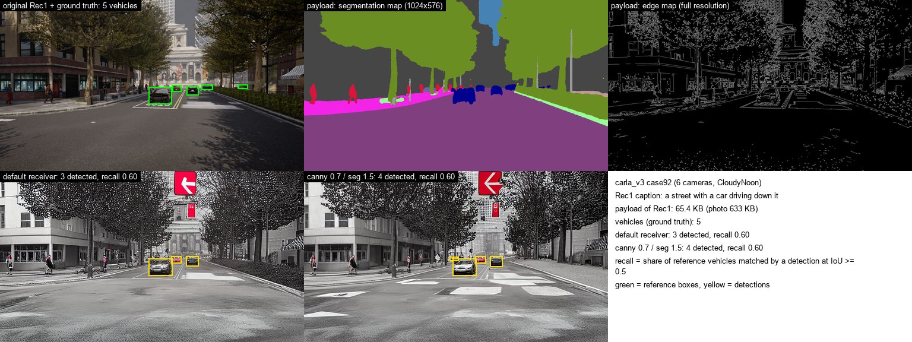

### carla_v3 case100

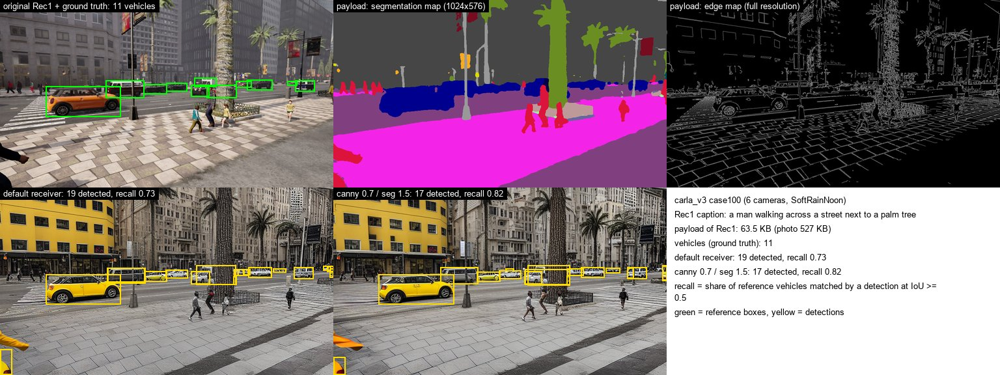

### carla_v3 case14

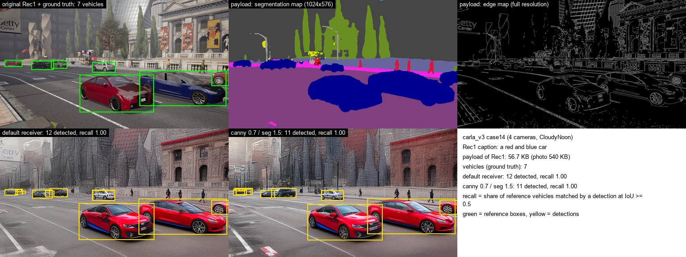

### real_world case235

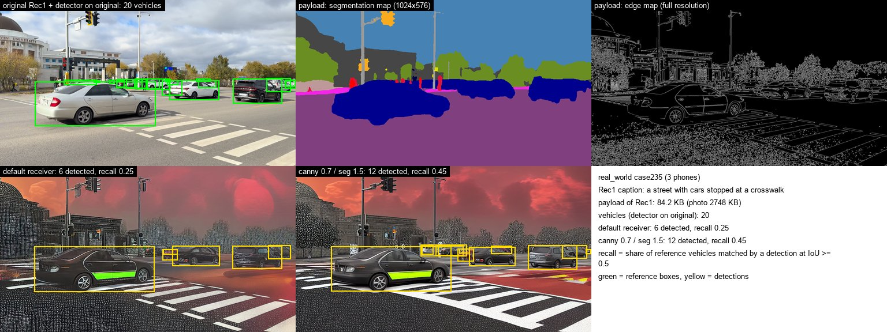

### real_world case289

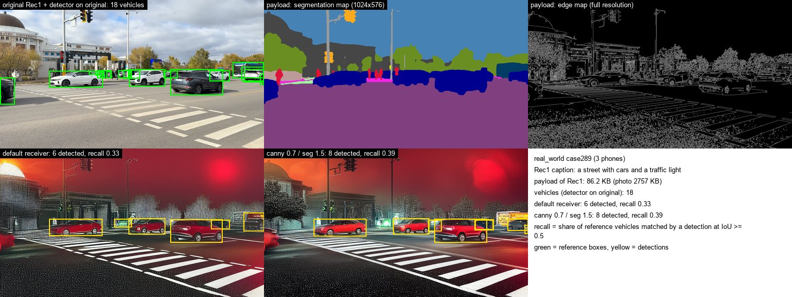

### real_world case319

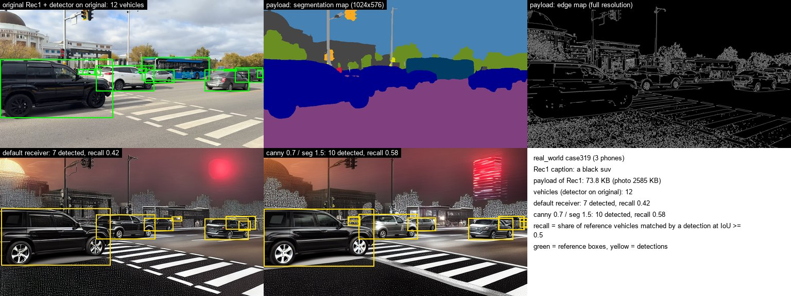

### real_world case73

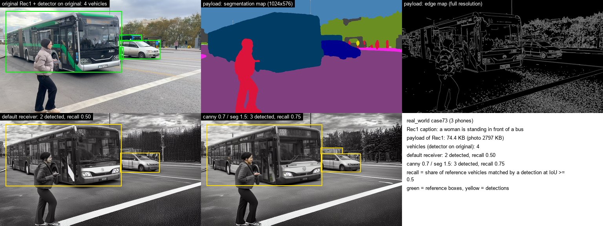

### real_world case307

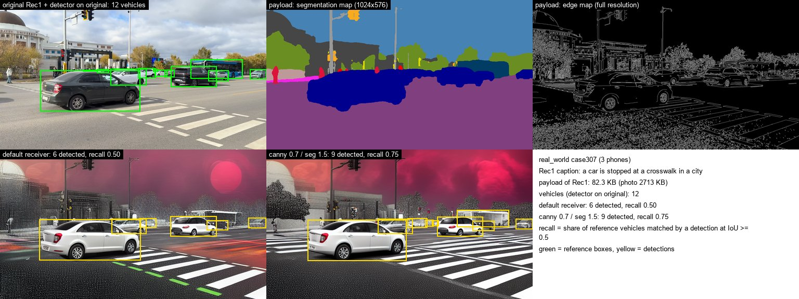

### real_world case109

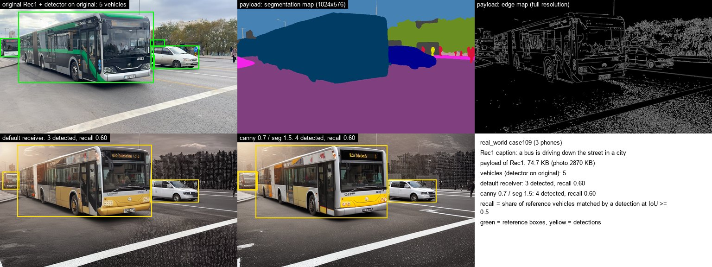

### real_world case13

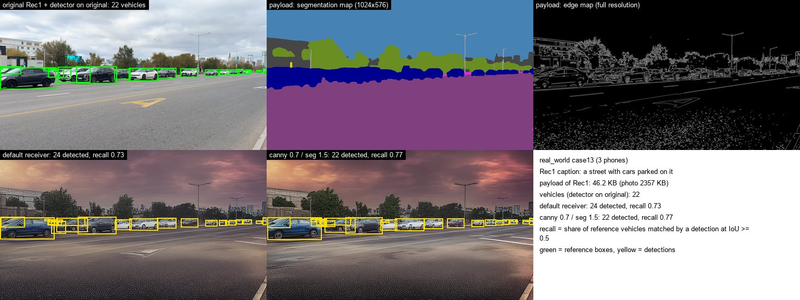

### real_world case49

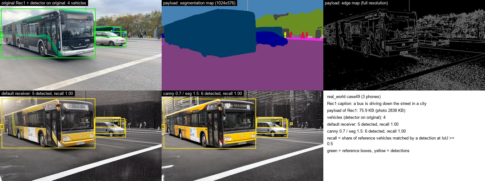
